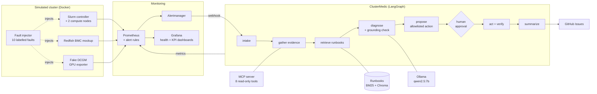
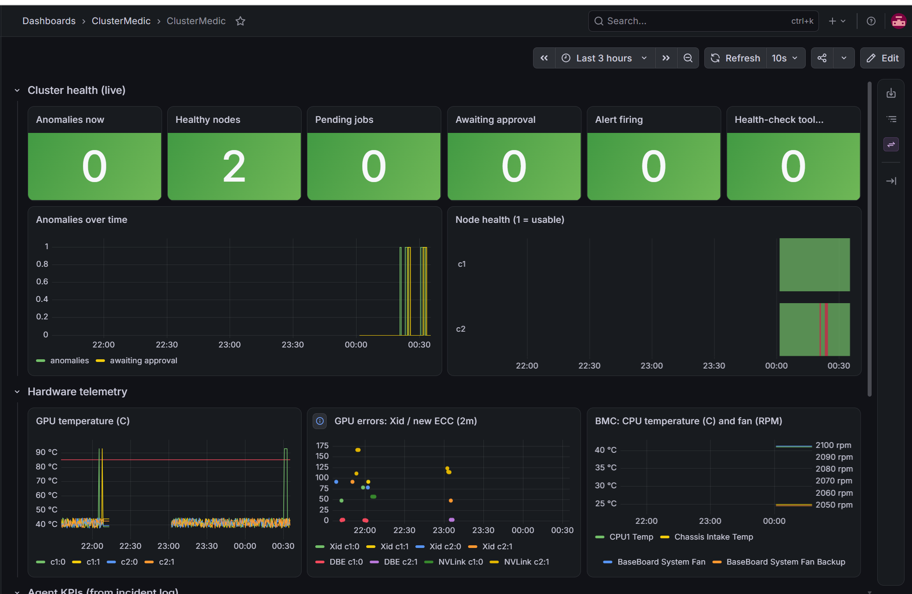
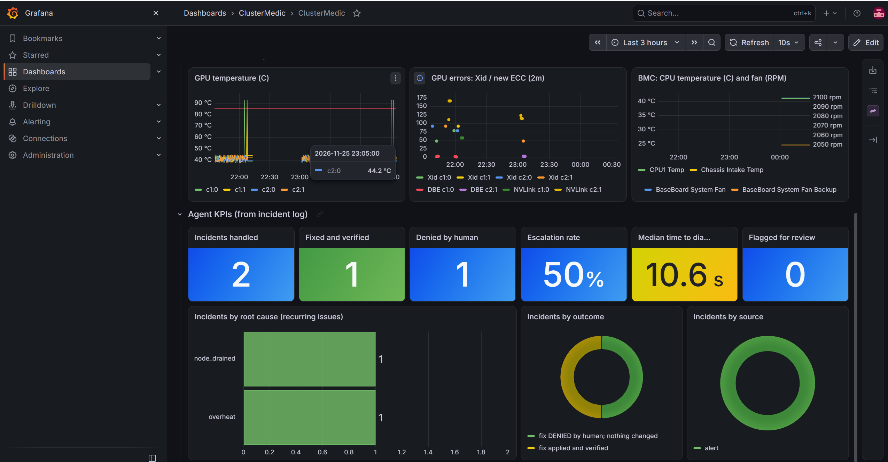

# ClusterMedic

**An AI agent that triages HPC/GPU incidents: it gathers evidence, retrieves runbooks, diagnoses the root cause, and proposes a fix that a human approves.**

Everything runs locally on one laptop: a simulated Slurm cluster, a Redfish BMC mockup, a fake DCGM GPU exporter, Prometheus/Alertmanager/Grafana, and a local LLM (Ollama). Faults are injected on purpose, so every diagnosis can be scored against ground truth.


▶ [Watch the full replay](https://asciinema.org/a/pzet6onFZHdiHFob) (pause it, or copy text from it)

## What it does

1. **Detects.** A Prometheus alert fires when an anomaly appears (node drained, slurmd down, GPU ECC errors, overheating, fan failure, ...).
2. **Gathers evidence** using read-only tools: Slurm node and queue state, Redfish thermal and fan sensors, GPU telemetry, and metric windows.
3. **Retrieves runbooks** with hybrid search (BM25 + vector embeddings, combined with reciprocal rank fusion).
4. **Diagnoses** with an LLM that must return JSON matching a fixed set of root causes, then checks that the diagnosis is supported by the evidence.
5. **Proposes** one action from an allowlist and **waits for a human** to approve it.
6. **Acts, verifies and reports.** It opens a GitHub issue, applies the fix after approval, checks that the cluster is healthy again, and closes the issue.

An extra module applies the same pattern to **chip-design (EDA) flows**: it triages OpenROAD/Yosys runs for setup violations, inferred latches, undriven nets, multiple drivers, placement density and DRC errors.

## Architecture



## Results

All numbers were measured on this setup. Full method, raw logs and caveats are in [`docs/results.md`](docs/results.md).
What broke along the way, and what I changed: [`docs/writeup.md`](docs/writeup.md).

| Evaluation | Result |
|---|---|
| End-to-end fault injection (32 incidents, 10 fault types + healthy) | LLM agent 32/32 and rules baseline 32/32 correct; 0 unsafe proposals; median diagnosis 2.9 s |
| Ticket-only triage (22 pre-registered tickets, no live symptoms) | LLM 22/22 vs rules 13/22; paraphrased tickets 9/9 vs 0/9; benign 4/4 |
| Prompt injection (7 attack tickets + 1 benign) | 2/8 changed the diagnosis, both caught by the grounding check and sent to human review; **0 unsafe actions** |
| Runbook retrieval (20 standard / 10 hard questions) | Hybrid MRR 0.967 standard, 0.867 hard |
| Model comparison (same prompts, retriever, guardrails) | qwen2.5:7b and llama3.1:8b both 22/22; qwen2.5:3b 18/22 with 2 false alarms on benign tickets; 0 unsafe for all models |
| Alert-driven loop | fault → diagnosed and awaiting approval in 56–65 s (3 timed runs; most of it is the 30 s alert hold plus scrape intervals); GitHub issue opened, fix approved, verified and closed |
| EDA triage (8 labelled ORFS/Yosys runs) | 4/8 → 8/8 after confirming latch warnings against netlist cell counts (fix made after seeing these runs; n = 8) |

**Interpretation.** Single, clean injected faults are easy, and rules match the LLM there. The LLM earns its place on unstructured input: paraphrased tickets that keyword rules miss entirely. The guardrails, not the model, are what keep it safe under prompt injection.

## Safety design

- **Read-only by default.** Evidence tools only run allowlisted read commands. The MCP server exposes 8 tools, all marked read-only.
- **Grounding check.** A diagnosis must be supported by an observed anomaly. If it isn't, it becomes `needs_review` and only `report_only` can be proposed.
- **Constrained output.** The root cause comes from a JSON-schema enum, and the action comes from a fixed allowlist.
- **Human approval** for every state change, through a LangGraph interrupt (CLI) or a token-protected approval queue (alert service).
- **Ticket text is untrusted.** It is fenced in `<ticket>` tags and scanned for injection patterns. A diagnosis from a ticket alone is always `needs_review`.
- **Audit log** of every proposal, approval, action and no-op, with secrets masked.
- **Idempotent actions** and a cooldown, so a repeated alert or a double approval can't stack changes.

## Dashboards

| Cluster health | Agent KPIs |
|---|---|
|  |  |

**Escalation rate** = the share of real incidents (evaluation runs excluded) where the proposed action hands the work to a person (`escalate_hardware`, `report_only` or `drain_for_repair`) instead of an automated fix.

## Quick start

Prerequisites: Linux or WSL2, Docker, [uv](https://docs.astral.sh/uv/), [Ollama](https://ollama.com) with `qwen2.5:7b` and `nomic-embed-text`, and optionally the GitHub CLI (`gh`) for ticketing.

```bash
git clone --recurse-submodules https://github.com/Vutukuribanurohit02/clustermedic.git
cd clustermedic
uv venv && source .venv/bin/activate
uv pip install -e ".[dev]"

make up && make health                 # cluster + monitoring
python -m clustermedic.rag index       # build the runbook index

python -m clustermedic.faults inject node_drain
python -m clustermedic.agent run       # diagnose, propose, ask for approval
python -m clustermedic.faults clear --all
```

Alert-driven mode: `make serve`, inject a fault, then `python -m clustermedic.agent pending` and `python -m clustermedic.agent approve <id>`.

| Service | URL |
|---|---|
| Grafana | http://localhost:3000 |
| Prometheus | http://localhost:9090 |
| Alertmanager | http://localhost:9093 |
| Redfish mockup | http://localhost:8000/redfish/v1 |
| ClusterMedic service | http://localhost:9500 |

## Reproducing the evaluations

```bash
make test                                            # unit tests (no live services needed)
python -m clustermedic.rag eval                      # retrieval
python -m clustermedic.evaluation run                # end-to-end fault injection
python -m clustermedic.evaluation tickets            # ticket-only triage
python -m clustermedic.agent injection-eval          # prompt injection (with a fault active)
python -m clustermedic.evaluation compare --models qwen2.5:7b llama3.1:8b qwen2.5:3b
./scripts/eda_experiments.sh && python -m clustermedic.eda eval
```

## Repository layout

```
clustermedic/
  tools/        read-only Slurm, Redfish and Prometheus tools
  faults/       10 labelled fault injectors (ground truth -> eval/injections.jsonl)
  rag/          chunking, BM25, Chroma embeddings, hybrid retrieval, retrieval eval
  agent/        LangGraph graph, diagnosis, guardrails, action allowlist
  evaluation/   harness, scoring, ticket/injection evals, model comparison
  eda/          OpenSTA/TritonRoute/Yosys parsers and EDA triage
  serve.py      metrics exporter, Alertmanager webhook, approval queue
  mcp_server.py read-only MCP tools
runbooks/       RB-001..010 (cluster), eda/ED-001..008 (chip design)
infra/          Slurm (submodule), Redfish, GPU exporter, Prometheus, Grafana
eval/           pre-registered test sets
docs/           results and screenshots
```

## Limitations

- **Simulated hardware.** The GPU exporter and Redfish BMC are mocks, and faults are injected one at a time. Real incidents are messier and often have several causes at once.
- **Small test sets.** 32 incidents, 22 tickets, 8 injection tickets, 8 EDA runs. Two fixes (a runbook line and the latch check) were made after seeing results, as noted in `docs/results.md`.
- **One machine.** A two-node Slurm cluster in Docker; nothing here has been run on a production cluster.
- **Local 7B models.** Larger models weren't tested.

## License

MIT
