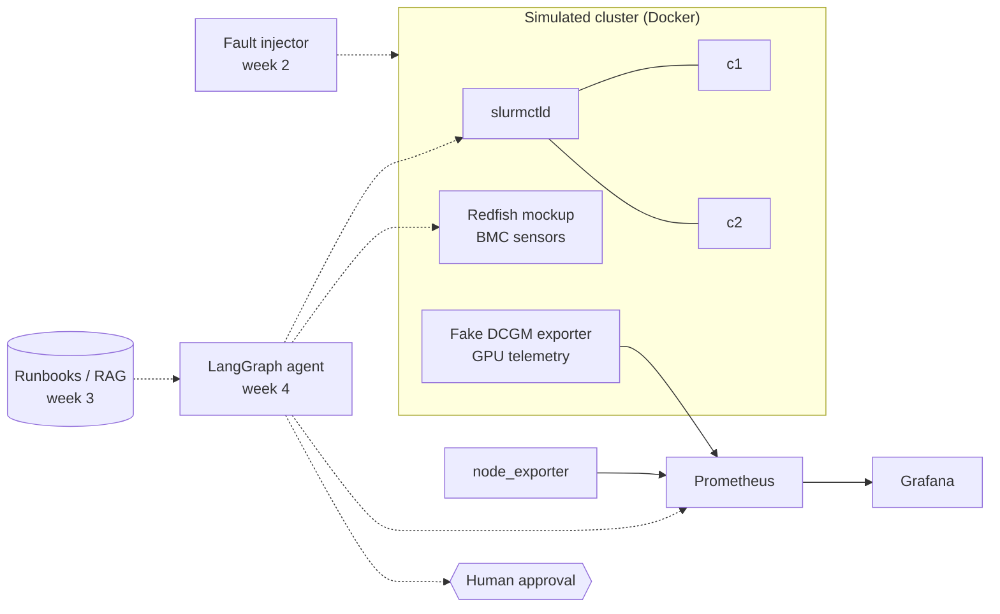

# ClusterMedic

An AI agent that triages HPC/GPU incidents: it gathers scheduler state, logs, BMC sensor data and GPU telemetry, retrieves runbooks, diagnoses the root cause, and proposes a fix that a human approves.

Everything runs locally in Docker. No real cluster or data-center GPU is needed.

> **Status: Week 1 of 6.** The simulated cluster, monitoring stack and runbooks are working. The agent, RAG, evaluation and dashboard are in progress.

## Architecture



## What works today

| Component | Details |
|---|---|
| Slurm cluster | Controller + 2 compute nodes (`c1`, `c2`) via [slurm-docker-cluster](https://github.com/giovtorres/slurm-docker-cluster) |
| Redfish mockup | DMTF Redfish Mockup Server: chassis temperatures, fans, power |
| GPU telemetry | Synthetic exporter using NVIDIA dcgm-exporter metric names; faults injected via a JSON file |
| Monitoring | Prometheus, node_exporter, Grafana with a provisioned data source |
| Health check | `make health` checks every service and exits non-zero on failure |
| Runbooks | 10 runbooks (RB-001 to RB-010) with metadata for retrieval and evaluation |

## Quick start

Requirements: Docker with Compose v2, about 10 GB RAM for Docker, Linux or Windows with WSL2.

```bash
git clone --recurse-submodules https://github.com/Vutukuribanurohit02/clustermedic.git
cd clustermedic
cp infra/slurm/.env.example infra/slurm/.env
make up
make health
```

| Service | URL |
|---|---|
| Grafana | http://localhost:3000 |
| Prometheus | http://localhost:9090 |
| Redfish | http://localhost:8000/redfish/v1 |
| GPU metrics | http://localhost:9400/metrics |

## Roadmap

- [x] Week 1: Cluster, Redfish, monitoring, runbooks
- [ ] Week 2: Fault injector (10+ fault types) and tool wrappers with tests
- [ ] Week 3: RAG over runbooks and docs
- [ ] Week 4: LangGraph agent, human approval, guardrails, ticketing
- [ ] Week 5: Evaluation suite, KPI dashboard, CI
- [ ] Week 6: Results write-up and demo
